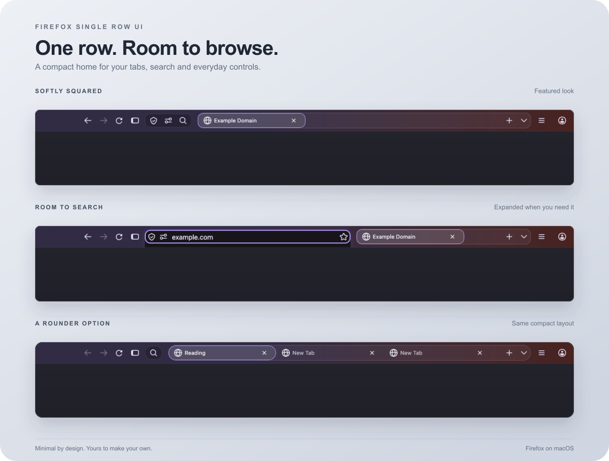
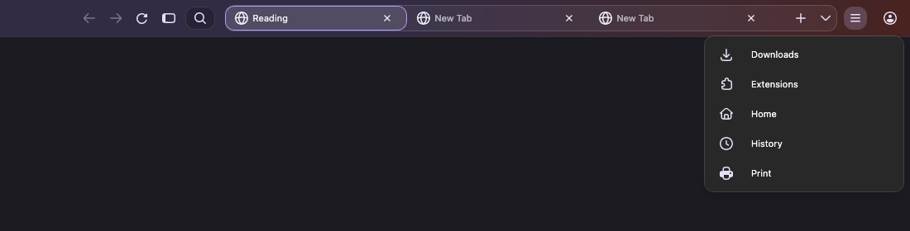

<h1 align="center">🌿 Firefox Single Row UI</h1>

A quieter Firefox for people who like to keep everything minimal. One compact toolbar, more room for the web.

- 🧭 Your tabs and everyday controls, together in one row.
- ✨ Search when you need it. Extra space when you don’t.
- 🎨 Make it yours with your favorite Firefox theme.

👀 More screenshots

**Search, ready when you are.**

**Site information, permissions and Search, together.**

**Tools tucked away until you need them.**

**More tabs, the same tidy row.**

### Prefer a rounder look?

## 🚀 Get started

Download **Code → Download ZIP**, then follow the [setup guide](docs/INSTALLATION.md).

Made for **Firefox on macOS with horizontal tabs**. See the [compatibility notes](docs/COMPATIBILITY.md) for tested setups and known issues.

Optional search extras use a helper that needs to be run again after restarting Firefox. [How to enable them →](docs/INSTALLATION.md#optional-browser-console-helpers)

## 💬 Make it better

Found something that feels off? [Report an issue](https://github.com/sakshamar20/firefox-single-row-ui/issues/new/choose) with your Firefox version and a screenshot.
