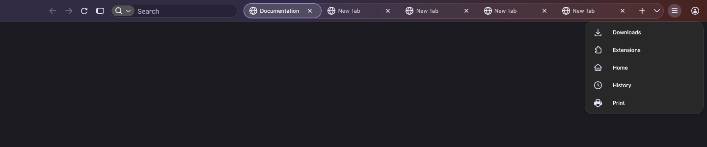

# Screenshot gallery

These are actual Firefox UI captures, not AI-generated mockups. They were made in a disposable headless Firefox 158.0.1 profile using the packaged CSS, neutral demo tabs and built-in generic icons. Home, History and Print were added through Firefox's normal customization API for the action-list example.

No personal browsing history, account photograph, location, uploaded user screenshots or real profile files were included. The browser automation indicator was hidden for capture; it is not part of an ordinary user session. Native macOS traffic lights are not rendered in headless screenshots. Example colors come from the capture environment, not an included theme.

## Normal toolbar

## Vertical hover list

## Compact tabs with overflow

To add your own screenshots, use a clean browser window, remove personal details, save the image in `assets/screenshots/`, and add a relative Markdown image link to the README. Native screenshot tools can capture only the toolbar to avoid including page content.

The README features the softly squared 11px style: `radius-11.png`, `squared-hover-actions.png` and `squared-many-tabs.png`. `rounded-comparison.png` shows the same toolbar at 16px. These were captured in the disposable Firefox profile with a saved radius preference, then the preference was reset. This presentation change does not change the packaged rounded default. Other original captures use the rounded 16px default. `radius-4.png` and `radius-16.png` show the same toolbar at two saved radius settings. Native macOS context menus are not rendered in headless screenshot output; these images demonstrate the changed corners rather than the menu itself.

The README search examples also use the featured 11px style. `squared-search-expanded.png` shows the native field focused and expanded; `squared-search-controls.png` shows native site-information, permission and search controls together. A location permission was added only to the disposable example.com test profile to show the permission indicator, then removed after capture.
