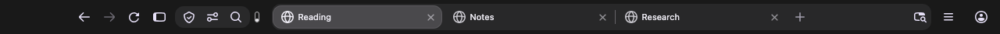
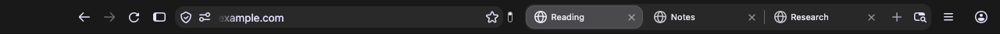
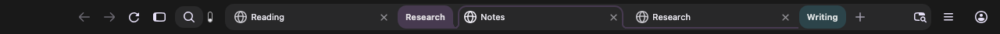
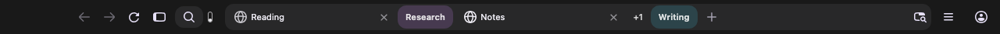
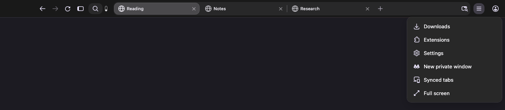
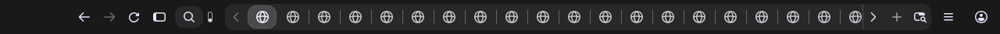
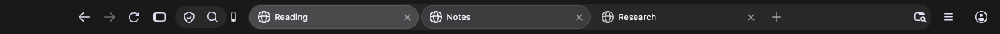

# Product images

The current gallery was captured with the packaged 1.7.0 CSS in an isolated headless Firefox 160.0 profile on macOS. All tabs have neutral demo labels. Search uses example.com; the tools menu is shown over a blank page. A neutral dark background was applied only to the capture window to keep the group line visible. It is not an included Firefox theme, and the toolbar geometry was not altered for capture.

No personal browsing history, account photograph, location, user screenshots or real profile files are included. The automation indicator was hidden for capture. Headless Firefox does not render native macOS traffic lights. A temporary location permission for example.com was used to expose the native permission control, then removed from the disposable profile; no location was requested or read.

## Search and native controls

## Tab groups

The group tag has a muted fill and an outward bottom-right curve. A continuous 2px line rises over the active tab, whose interior remains unfilled.

Collapsed groups have no underline or outward wedge. Firefox can keep the active member visible.

## Tools palette

## Compact tabs and scrolling

## Corner options

The default is 11px. The comparison uses the optional saved 16px radius; the gallery also includes 4px and 16px captures. Saved radius preferences were reset after capture.

## Presentation board

`assets/screenshots/showcase.png` combines these actual toolbar captures with labels, shadows and blank decorative window canvases. It is a product presentation, not a full-window screenshot. `showcase.svg` contains the editable composition. Existing image filenames are refreshed with the current release so older links remain usable.
